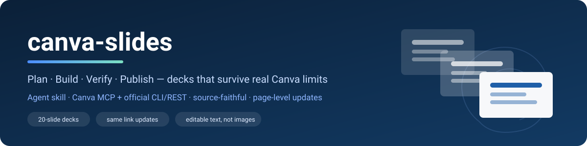
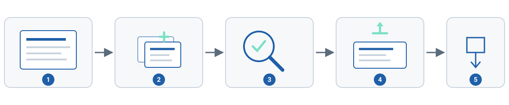

<div align="center">



### Làm slide Canva chịu được giới hạn thật của Canva

**Lập kế hoạch · Dựng · Kiểm chứng · Xuất bản** — bám nguồn, sửa được toàn bộ, một link không bao giờ đổi.

[](LICENSE)
[](skills/canva-slides/SKILL.md)
[](#cấu-trúc-repo)
[](skills/canva-slides/references/00-preflight-and-environment.md)
[](skills/canva-slides/SOURCES.md)

[English](README.md) · [中文](README.zh.md) · **Tiếng Việt** · [Русский](README.ru.md) · [Français](README.fr.md) · [Español](README.es.md)

</div>

---

## Vì sao có skill này

Phần lớn skill "làm slide giúp tôi" dựa vào hai giả định thường sai:

1. **Lệnh tạo deck của AI chạy được.** Không — khi hạn mức AI tháng đã hết, `create-design` trả `quota_exceeded` ngay lập tức, thử lại bao nhiêu cũng vậy.
2. **Deck tạo ra rồi sửa được.** Không sửa cấu trúc được: không có thao tác nào thêm được text box, và dịch vụ chỉnh sửa có thể trả `503` hàng giờ.

Skill này ghi lại đúng những gì đã trụ được khi thử thật: chốt kế hoạch trước khi vẽ, so từng chuỗi chữ với nguồn, **xem từng trang đã render**, và một đường lui không cần Canva AI — dựng PPTX native sửa được rồi import bằng REST import chính thức của Canva.

## Bạn nhận được gì

- **Hỏi trước khi dựng** —— bộ câu hỏi sinh theo chủ đề (theme, mật độ, ngôn ngữ thị giác, hình ảnh, trích dẫn, slide đặc biệt); câu trả lời ghi vào plan, thiếu thì linter chặn.
- **Kế hoạch trước, vẽ sau** — mạch bài, chế độ (presenter / talk / document), tiêu đề hành động từng trang, hạn mức từ, độ phủ ví dụ; linter chặn cấu trúc sai trước khi tạo.
- **Bám nguồn** — bảng đối chiếu slide ↔ trang (`nguon-doi-chieu.md`) cho deck từ giáo trình/PDF; ví dụ ngoài nguồn được ghi rõ ngay trên slide.
- **Hệ thị giác, không phải cảm tính** — thang cỡ chữ px cho 1920×1080, một màu nhấn, lưới và lề cố định, danh sách cấm rõ ràng, sơ đồ native.
- **Bằng chứng, không lời hứa** — diff chữ với plan, render từng trang, contact sheet, audit bố cục đo được (lệch, tràn, chồng, vùng an toàn).
- **Một link duy nhất** — thay ở mức trang qua `POST /v1/merges`; design id, link và quyền public giữ nguyên sau mỗi lần cập nhật.
- **Đầu ra sửa được** — text box và vector thật trong Canva, không bao giờ là ảnh phủ cả slide.
- **Hạ cấp mềm** — MCP → CLI/REST → PPTX local, chọn theo cái đang chạy được lúc đó.
- **Tiếng Việt trước** — dấu đầy đủ, dự đoán xuống dòng, cỡ chữ cho lớp học, playbook đồ án/tiểu luận.

## Cài đặt

```bash
# omp managed skills
cp -R skills/canva-slides ~/.omp/agent/managed-skills/canva-slides

# agent khác đọc SKILL.md (Claude Code, Codex, …)
git clone https://github.com/thomas-nguyen-seamless/ai-skills-canva
cp -R ai-skills-canva/skills/canva-slides <thư-mục-skills-của-bạn>/
```

Rồi để skill tự chuẩn bị máy:

```bash
skills/canva-slides/scripts/bootstrap.sh # hỏi từng món còn thiếu
skills/canva-slides/scripts/bootstrap.sh --check # chỉ báo cáo, không cài gì
```

`bootstrap.sh` **chỉ cài thứ còn thiếu** — cái đã có sẽ báo `[ok] … (already installed, skipped)` và không cài lại. Sau đó nó kiểm hai việc không thể làm thay bạn: đăng nhập Canva CLI và mount MCP.

| Kiểm | Đã có thì | Thiếu thì |
|---|---|---|
| `uv`, `python3`, `git`, `node ≥ 22`, `npx` | báo ok, không đụng vào | cài bằng Homebrew (hoặc installer chính thức của `uv`) |
| Canva CLI | báo ok, không tải lại | tải một lần qua `npx` (cache, không cài global) |
| Thư viện Python (`pillow`, `numpy`, `scipy`, `python-pptx`, `lxml`, `pymupdf`, `pypdf`) | import được → bỏ qua | nạp sẵn vào cache uv |
| Đăng nhập Canva CLI | in tên tài khoản | `canva login`, **bạn bấm duyệt trên trình duyệt** |
| Mount MCP `canva` | xác nhận trong `mcp.json` | in snippet; **không ghi đè** config |

## Bắt đầu nhanh

**Deck mới**

```text
/skill:canva-slides làm 20 slide về "quy luật phủ định của phủ định" từ @triethocmaclenin.pdf,
15 phút, tiếng Việt, chữ lớn cho giảng đường
```

**Sửa deck đang có, giữ link**

```bash
scripts/update_canva_deck.sh DAHaPZNNOhs deck.pptx "tmp import" --pages "5,9"
```

**Chỉ nhận xét, không sửa gì**

```text
/skill:canva-slides nhận xét deck Canva này: https://canva.link/… — chấm điểm, liệt kê lỗi
```

## Một deck được dựng thế nào

<div align="center"></div>

| # | Pha | Cửa chặn trước khi đi tiếp |
|---|---|---|
| 1 | **Kế hoạch** — intake, bảng nguồn, thuật ngữ, hồ sơ từng trang, ví dụ | `plan_check.py --ghost` báo **0 lỗi** |
| 2 | **Dựng** — Canva AI (`create-design`) *hoặc* PPTX native, chữ Arial, đo chiều cao thật | số trang khớp kế hoạch |
| 3 | **Kiểm chứng** — diff chữ, render từng trang, audit bố cục, tương phản | đủ mọi chuỗi, không còn lỗi nặng |
| 4 | **Xuất bản** — import một lần, sau đó cập nhật theo trang trên cùng design | số trang khớp, link và quyền chia sẻ còn nguyên |
| 5 | **Xuất file** — PDF/PPTX, đếm lại số trang, ghi chú để file riêng | tick đủ checklist hoàn thành |

## Cập nhật deck dùng chung

Mặc định là **từng trang**, vì deck thường có nhiều người sửa:

```bash
scripts/update_canva_deck.sh <ID> deck.pptx "tmp" --pages "5,7,12-14" # chỉ các trang này đổi
scripts/update_canva_deck.sh <ID> deck.pptx "tmp" --all # toàn bộ (chỉ deck riêng)
scripts/update_canva_deck.sh <ID> deck.pptx "tmp" # từ chối chạy
```

Mỗi trang là 2 job merge (insert + delete) nên tổng số trang không đổi, số trang không lệch giữa chừng. Đã kiểm trên design 20 trang: thay trang 5 chỉ làm **trang 5** đổi (1.266 px), 19 trang còn lại giống hệt từng pixel, design id, short link và quyền `Can view` giữ nguyên.

> Trang bị thay là trang mới từ bản build local, nên chỉnh tay **trên chính trang đó** sẽ mất. Các trang khác không bị đụng.

## Script

| Script | Việc |
|---|---|
| `bootstrap.sh` | cài phần thiếu; kiểm đăng nhập và mount MCP |
| `intake_prompt.py` | sinh bộ câu hỏi thiết kế theo chủ đề trước khi dựng |
| `plan_check.py` | lint kế hoạch: hạn mức từ, tiêu đề, trùng lặp, nhịp, mục lục, ví dụ, ghost-deck |
| `text_diff.py` | đối chiếu chuỗi dự kiến với chữ thực tế |
| `deck_audit.py` | audit bố cục đo được: lệch tiêu đề, vùng an toàn, tràn, chồng, dấu hiệu AI |
| `fit_check.py` | dự đoán xuống dòng và chiều cao tiếng Việt trước khi sửa |
| `contrast.py` | tương phản WCAG cho máy chiếu |
| `diagrams.py` | 8 kiểu sơ đồ, render đúng cỡ slide |
| `contact_sheet.py` | một ảnh gồm mọi trang, có nhãn |
| `post_upload.sh` | upload asset một lần |
| `update_canva_deck.sh` | đẩy PPTX vào design có sẵn, giữ id, link, quyền chia sẻ |
| `templates/pptx-fallback/` | builder native, xử lý tranh khắc, render PowerPoint, verify chữ |

## Cấu trúc repo

```text
ai-skills-canva/
├── assets/ ảnh bìa + sơ đồ quy trình
├── README.md README 6 thứ tiếng (EN · VI · ZH · RU · FR · ES)
└── skills/canva-slides/ 1 skill, nhưng rất sâu
 ├── SKILL.md router: luật, pha, shortcut, tool, script
 ├── SOURCES.md nguồn gốc, quyết định, log kiểm chứng theo ngày
 ├── references/00…12 mỗi pha một file
 ├── scripts/ 10 script ở trên
 ├── templates/ plan.json, brief-vi, deck-rules, speaker-notes,
 │ mcp-canva.snippet.json, pptx-fallback/
 └── research/ ghi chú khảo sát skill khác (có ghi nguồn)
```

## Giới hạn được ghi vào skill

| Thực tế | Skill làm gì |
|---|---|
| `create-design` / `generate-image` tiêu hạn mức **AI tháng** (`quota_exceeded`, trả ngay) | dừng ngay, chuyển đường không cần credit, báo ngày reset |
| `start-editing-transaction` có thể `503` hàng giờ | hạ xuống đọc + export + merge theo trang; không bao giờ nói đã sửa khi chưa commit |
| Bộ import PPTX của Canva bỏ padding trong khung, khoảng cách đoạn, nét freeform | mỗi đoạn một text box, khung trơn + chữ riêng, đường cong vẽ bằng polygon tô |
| Không API nào chia sẻ public hay xoá design | ghi rõ thao tác UI, không bịa lệnh |
| Deck sinh ra hay paraphrase, có thể đổi thuật ngữ | diff với plan; sửa tại chỗ, không tạo lại để sửa chữ |

Bằng chứng đầy đủ, ngày và nguồn: [`skills/canva-slides/SOURCES.md`](skills/canva-slides/SOURCES.md).

## Giấy phép

MIT — xem [LICENSE](LICENSE). Ghi công bên thứ ba ở [NOTICE.md](NOTICE.md). Canva là nhãn hiệu của Canva Pty Ltd; dự án này không liên kết và không được Canva bảo trợ.
